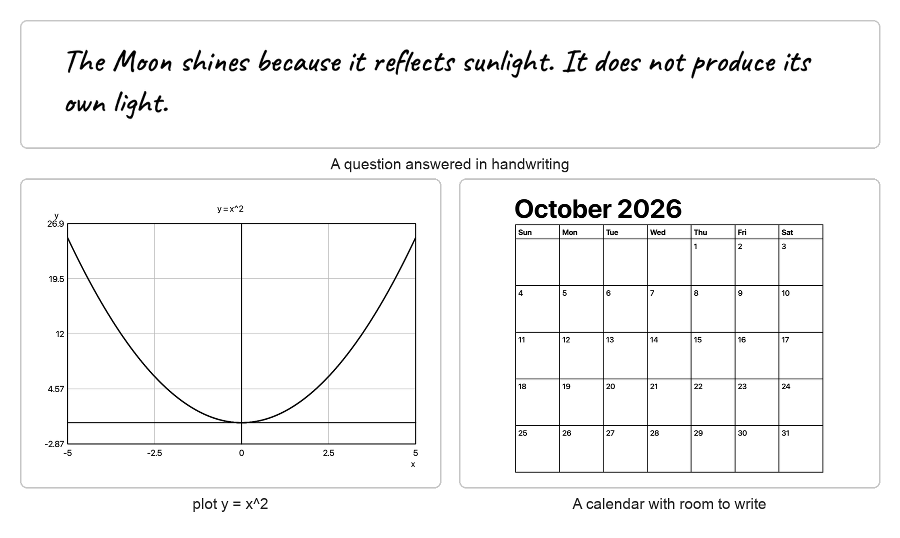
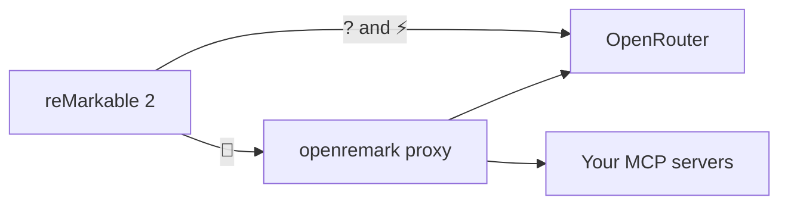

# openremark

**Ask your reMarkable 2 a question in handwriting. The answer appears on the page, in handwriting.**

Write a question in any notebook and tap a button. openremark sends the page to an AI model, by default a free one on [OpenRouter](https://openrouter.ai), and writes the answer below your question. With the optional proxy, the model can also use your own tools through [MCP](https://modelcontextprotocol.io): your calendar, your notes or your own services.



[Install](INSTALL.md) · [Add an MCP server](#add-an-mcp-server) · [Settings](#settings) · [Changelog](CHANGELOG.md)

## What openremark adds

openremark builds on [remarkable-claude](https://github.com/jonaslaberg/remarkable-claude) and [remarkable-chatgpt](https://github.com/mmoscat/remarkable-chatgpt), which read the page and render the answers. On top of them it adds:

- 🆓 **Free to start.** Any OpenAI-compatible API works, and the default is a free OpenRouter model that reads images. An OpenRouter key is all you need.
- 🔘 **Three buttons:** a free model, a fast paid model, and a model that can use your tools.
- 🧰 **Your own tools through MCP.** A small proxy gives the model the tools of any MCP server. Anything that could change something needs a written *yes* on the page first.
- 🔎 **Web search** through OpenRouter. Only the answer goes on the page; the sources are saved beside it.
- 🧾 **Traceable answers.** Every answer keeps the ids of its requests, so you can look up exactly what the model saw and said.

Email and brand names from remarkable-claude are removed. Tested on OS 3.29.1.0 ([VALIDATION.md](VALIDATION.md)).

## The three buttons

They sit at the top right of the page, under the toolbar's close button.

| Button | What it does | Model by default |
|:---:|---|---|
| **?** | Asks the free model | `nvidia/nemotron-3.5-super-vl:free` |
| ⚡ | Asks a faster, paid model | `anthropic/claude-haiku-5.5`, no reasoning |
| 🔧 | Asks through the proxy, with your MCP tools | same as ⚡ |

? and ⚡ go straight to OpenRouter, so they keep working when the proxy is down. Each button can use another model in [Settings](#settings).



## Get started

1. **Install** the plugin on the tablet: [INSTALL.md](INSTALL.md) takes about 20 minutes over SSH.
2. **Add your key:** create one at [openrouter.ai/keys](https://openrouter.ai/keys) and run `sh /home/root/.config/ink-diary/configure.sh` on the tablet.
3. **Ask:** open a notebook in portrait, write a short question and tap **?**.

While it works, the button shows a stop square; tap it to cancel. To remove an answer, use Undo, or select it and delete it.

**What you can ask for**

- **Anything**, answered in handwriting, with lists and tables when they help.
- **Current facts:** write `Search` first, for example `Search weather in Stockholm today`. Questions about the news or prices usually search on their own.
- **Plots:** `plot y = sin(x)` or `plot y = 2x + 1 from x = -10 to 10`.
- **Diagrams:** `Create a flowchart for making tea`, a sequence diagram, or a Venn diagram with 2 or 3 sets.
- **Templates:** `Create a 10 item checklist`, a table with blank rows, or `Create a calendar for November 2026 with each day cell 3 rows tall`.

Write in the language you want the answer in. A single word such as `Search UEFA` shows no language and may be answered in English; `Search ge mig info om UEFA` is answered in Swedish. If the model misreads a word, write the corrected word under its answer and tap again.

## Add an MCP server

Follow these steps in order. They work the same for a person or a coding agent. Every field is described in [proxy/README.md](proxy/README.md).

> **The server must** speak MCP over Streamable HTTP and accept a fixed key in a header, such as `Authorization: Bearer …`. Servers that only allow an interactive OAuth login cannot be used, because the proxy cannot click a login link.

### 1. Run the proxy

You do this once, on any machine the tablet can reach. Use `https` for anything outside your own network. It needs Node.js 24 or Docker (`proxy/Dockerfile`).

```json
{
  "listen": 8787,
  "client_key": "${OPENREMARK_CLIENT_KEY}",
  "upstream": { "base_url": "https://openrouter.ai/api/v1", "api_key": "${OPENROUTER_API_KEY}" },
  "mcp_servers": []
}
```

Save it as `proxy/config.json`, or put it in the environment variable `CONFIG_JSON` on hosts that do not mount files. `${NAME}` is read from the environment variable `NAME`, so keys never sit in the file:

- `OPENREMARK_CLIENT_KEY`: a new key for the tablet, for example from `openssl rand -hex 24`.
- `OPENROUTER_API_KEY`: your OpenRouter key. It stays on the proxy.

Start the proxy with `node src/server.ts` in `proxy/`. `GET /health` answers `{"ok":true}`.

### 2. Add the server

Add an entry to `mcp_servers`:

```json
{
  "name": "notes",
  "url": "https://notes.example.com/mcp",
  "headers": { "Authorization": "Bearer ${NOTES_TOKEN}" }
}
```

| Field | Meaning |
|---|---|
| `name` | `a-z`, `0-9`, `_`, `-`, at most 32 characters. The model sees the tools as `notes__<tool>`. |
| `url` | The server's Streamable HTTP endpoint. |
| `headers` | Whatever the server needs. Keep the secret in an environment variable (`NOTES_TOKEN` here). |
| `confirm` | Optional. Tools that always need a written *yes*. |
| `confirm_destructive` | Optional, default `true`. Also asks for a *yes* before any tool that does not mark itself read-only (`readOnlyHint`) or non-destructive (`destructiveHint: false`). |

### 3. Restart the proxy

The proxy reads its configuration only when it starts. It caches each server's tool list for 5 minutes.

### 4. Point the 🔧 button at the proxy

You do this once, on the tablet over SSH. Both commands read their value from stdin, so the key stays out of the shell history:

```sh
cd /home/root/.config/ink-diary
echo 'https://proxy.example.com/v1' | ./config-model --set tools_base_url
read -rs KEY && echo "$KEY" | ./config-model --set tools_api_key; unset KEY
```

### 5. Check it

Run this from any computer before trying the tablet:

```sh
curl -s https://proxy.example.com/v1/chat/completions \
  -H "Authorization: Bearer $OPENREMARK_CLIENT_KEY" -H "Content-Type: application/json" \
  -d '{"model":"anthropic/claude-haiku-5.5","messages":[{"role":"system","content":"Answer briefly."},{"role":"user","content":"What is on my notes list today?"}]}'
```

When a tool was used, the proxy's log line for the request ends with `tools=notes__…`.

**Tips**

- The model picks a server from the server's own MCP **instructions** and tool **descriptions**, which the proxy passes on. If the model does not use a server when it should, improve those texts first.
- 🔧 uses ⚡'s model unless `tools_model` is set. Small free models are less reliable at choosing tools.
- A question with tools costs at least two model requests.
- One proxy serves one tablet.
- A server that does not answer is skipped, and the model is told so.

## Settings

Settings live in `/home/root/.config/ink-diary/config.json` on the tablet, readable only by root. `configure.sh` sets the key, model and timezone. `config-model --set KEY` changes one value at a time.

| Key | Default | Meaning |
|---|---|---|
| `api_key` | — | Key for `base_url` |
| `base_url` | `https://openrouter.ai/api/v1` | API for ? and ⚡. Plain `http` only on your own network |
| `model` | `nvidia/nemotron-3.5-super-vl:free` | Model for ?. It must read images |
| `effort` | — | `low`, `medium` or `high` for models that reason |
| `premium_model` / `premium_effort` | `anthropic/claude-haiku-5.5` / `none` | Model for ⚡ |
| `tools_base_url` / `tools_api_key` | — | The proxy for 🔧 and its `client_key` |
| `tools_model` | ⚡'s model | Model for 🔧 |
| `timezone` | `America/New_York` | For example `Europe/Stockholm` |
| `web_search` | `true` | `false` turns web search off. Searches cost money even with free models |
| `demo_mode` | `false` | `true` inserts a sample answer without any request |

To give 🔧 an icon of your own, put a square SVG at `/home/root/.config/ink-diary/ask-tools.svg`. Reinstalling keeps it.

<details>
<summary><b>Free models and limits</b></summary>

OpenRouter's free models allow 20 requests a minute and 50 a day, or 1000 a day once you have bought at least 10 USD of credits. The button tells you when the limit is reached. List the free models that read images:

```sh
curl -s https://openrouter.ai/api/v1/models | python3 -c "import json,sys; [print(m['id']) for m in json.load(sys.stdin)['data'] if m['id'].endswith(':free') and 'image' in m['architecture']['input_modalities']]"
```

</details>

<details>
<summary><b>How it works</b></summary>

1. The tablet takes a screenshot of the page and masks out its own buttons.
2. It sends the screenshot with a prompt that asks for one structured answer: text, a search, a plot, a diagram, a checklist, a table or a calendar. The prompt includes the tablet's date and time, so "today" means today.
3. A search makes a second request with OpenRouter's web plugin.
4. The tablet renders the answer itself (handwriting, plot, diagram or template) and inserts it as one image below your writing.

With 🔧 the proxy sits in the middle. It adds the MCP servers' tools and instructions to the request, runs the tools the model asks for, and returns the final answer in the same format. The tablet does not know the proxy is there.

</details>

<details>
<summary><b>Limits</b></summary>

- Portrait orientation only. Write inside the capture area (screen pixels x 150–1323, y 0–1751). Light template rules are ignored; dark or busy templates may be read as ink.
- The visible page is the only conversation history. A follow-up works while the earlier answer is on screen.
- Answers are images, not pen strokes, and have a maximum size. Very long answers are refused with a request to shorten them.
- Plots handle one explicit function y = f(x). Diagrams are a subset of Mermaid drawn on the tablet. There is no image generation.
- Font coverage limits languages and symbols. Unsupported characters give an error instead of missing letters.
- The plugin refuses to load if the firmware's Qt is older than, or a different major version from, the Qt it was built with. Firmware updates can still change the notebook app's internals; rebuild with the matching SDK if they do.
- After a reboot the buttons are gone until `bash /home/root/xovi/start` runs, or until you triple-press the power button with xovi-tripletap ([INSTALL.md](INSTALL.md)).

</details>

<details>
<summary><b>Privacy</b></summary>

Only tapping a button sends anything. The cropped page image goes over HTTPS to `base_url`, or to the proxy for 🔧, and on to the model provider; their data policies apply, and free models may log prompts. A web search sends the question in a second request. Screenshots are deleted after each run.

Answer images stay in `/home/root/.local/share/ink-diary/answers`, readable only by root, with their Markdown (`.png.md`), sources (`.png.html`) and request ids (`.png.ids`). With OpenRouter's input/output logging on, those ids show you the page image and the model's raw answer in your OpenRouter account. Keys and page content are never written to logs, on the tablet or in the proxy.

</details>

<details>
<summary><b>Removal</b></summary>

```sh
sh /home/root/openremark/uninstall.sh
```

Restart the UI afterwards. Your notebooks stay. Your key stays in `/home/root/.config/ink-diary/config.json`; delete that file to remove it.

</details>

<details>
<summary><b>Build and test</b></summary>

Build with the official rM2 SDK for your tablet's OS version (https://developer.remarkable.com/links). The checked-in `bin/ink-diary.so` and `bin/config-model` use SDK 3.28.0.172 (Qt 6.10.3). The SDK runs on Linux. On a Mac, use a Linux VM and build from the VM's own disk: macOS filesystems are case-insensitive, and the repo's `VERSION` file then shadows the C++ `<version>` header.

```sh
export SDK_ENV=/absolute/path/to/sdk/environment-setup-cortexa7hf-neon-remarkable-linux-gnueabi
export XOVI_REPO=/absolute/path/to/xovi
./build.sh
```

Tests on your computer need a C++ compiler with Qt 6 Core/Gui, and Node.js 24 with pnpm for the proxy:

```sh
./test.sh
node tests/append.cjs
cd proxy && pnpm install && pnpm test && pnpm typecheck
```

They cover the request and answer formats, the button masks, the settings, font rendering, and the proxy's tool loop against a fake MCP server. Live requests and the tablet itself are covered by [VALIDATION.md](VALIDATION.md).

</details>

## Credits and licence

openremark is a fork of [jonaslaberg/remarkable-claude](https://github.com/jonaslaberg/remarkable-claude), itself a fork of [mmoscat/remarkable-chatgpt](https://github.com/mmoscat/remarkable-chatgpt) (Ink Diary 4.1). GPL-3.0. Third-party code and fonts: [THIRD_PARTY.md](THIRD_PARTY.md). This is a development prototype.
